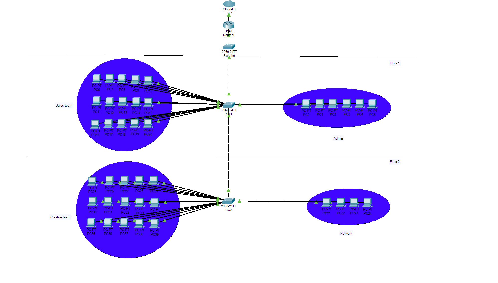
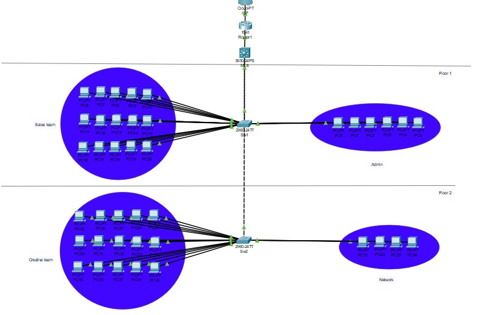

# 🌐 Fresh Blooms Trading: Network Redesign (CCNA 2)

Network design project for **Switching, Routing and Wireless Essentials (CCNA 2)** at the **National University of Malaysia (UKM)**.
The project analyses a small company's flat, insecure network and proposes a segmented, more reliable and hardened design, modelled in **Cisco Packet Tracer**.

📄 Full report: [`Network_project.docx`](Network_project.docx)

---

## 📌 Scenario

**Fresh Blooms Trading** is an e-business company that sells and delivers fresh flowers and customized gifts nationwide.
It has **40 staff** in four teams, working from a two-storey open-plan office (20 staff per floor):

| Team | Staff |
|:---|:---:|
| Admin | 6 |
| IT / Network | 4 |
| Sales | 15 |
| Creative | 15 |

**Existing infrastructure:** one router connected to the local ISP, one distribution switch, and two access switches (one per floor) connecting PCs and laptops.

## ⚠️ Problems

- 🐢 **Slow, unstable connections** caused by heavy file transfers in the Creative team
- 🔗 **Unstable trunk links** between the access switches and the distribution switch
- 🧱 **One flat network**: every device sits in the default VLAN on `192.168.1.0/24`, so all users share a single broadcast domain
- 🔓 **Weak security**: remote access through **Telnet** and only basic switch configuration

---

## 🗺️ Current Network

  

**Current IP addressing**

| Item | Value |
|:---|:---|
| Network | `192.168.1.0/24` |
| Subnet mask | `255.255.255.0` |
| Default gateway | `192.168.1.1` (Router) |
| Addressing | Static IPs assumed |
| Broadcast domains | One for all users, which increases congestion |

---

## 💡 Proposed Solution

| Solution | What it does | Problem it solves | Benefits |
|:---|:---|:---|:---|
| **VLANs per department** | Splits the network into smaller broadcast domains | Slow connections, heavy file sharing | Better performance and bandwidth; traffic is limited to each VLAN |
| **STP (Spanning Tree Protocol)** | Prevents bridge loops and broadcast storms on redundant links | Unstable links, heavy file sharing | Higher resilience with backup paths when a link fails |
| **Router-on-a-Stick** | Routes between VLANs over a single router interface using subinterfaces | Need for controlled, secure inter-VLAN traffic | Isolates VLAN traffic, improves security, centralizes routing |

---

## 🧮 New IP Addressing Scheme

| VLAN | Department | Subnet | Gateway | Hosts Needed |
|:---:|:---|:---|:---|:---:|
| 10 | Admin | `192.168.10.0/24` | `192.168.10.1` | 6 |
| 20 | Network | `192.168.20.0/24` | `192.168.20.1` | 4 |
| 30 | Sales | `192.168.30.0/24` | `192.168.30.1` | 15 |
| 40 | Creative | `192.168.40.0/24` | `192.168.40.1` | 15 |
| 99 | Management | `192.168.99.0/24` | `192.168.99.254` | 3 switches |

---

## ⚙️ Reducing Administration Workload

- **DHCP** assigns IP addresses automatically instead of static configuration
- A dedicated **management VLAN (VLAN 99)** for switch administration
- **SSH** for secure remote access
- Centralized configuration and **port descriptions**

---

## 🔐 Security Enhancements

| Security Issue | Solution / Configuration |
|:---|:---|
| Everyone in the default VLAN | Create department VLANs and assign users to them |
| Unused ports active | Shut down unused ports (`interface range fa0/10 - 24` → `shutdown`) |
| Unsecured switch management | Static management IPs in **VLAN 99** |
| Insecure remote access (Telnet) | Enable **SSH**; disable unnecessary services such as **CDP** |
| Weak authentication | Strong login credentials and **warning/login banners** |

---

## 🗺️ New Network Topology

  

- Router subinterfaces for inter-VLAN routing: `G0/0.10`, `G0/0.20`, `G0/0.30`, `G0/0.40`
- **Trunk links** from the router to the distribution switch, and from the distribution switch to the access switches
- Switch ports assigned to their department VLANs
- A **DHCP pool per VLAN**
- **VLAN 99** for switch management

---

## 🛠️ Concepts & Tools

`VLANs` · `802.1Q Trunking` · `STP` · `Router-on-a-Stick` · `DHCP` · `SSH` · `Switch Hardening` · `IP Addressing`

---

## 👩‍💻 Author

**[Esraa Halboup](https://github.com/esraaH2)**: Computer Science (Networks), UKM
